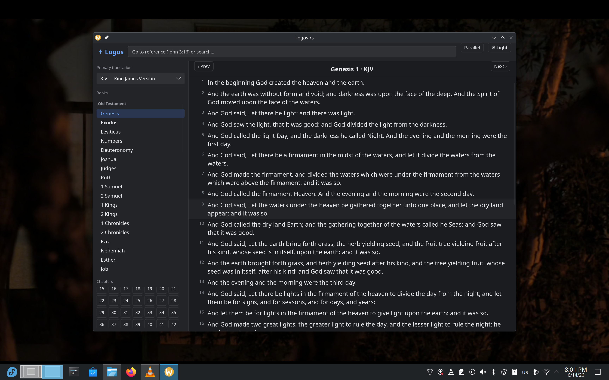

# logos-rs

A Linux desktop Bible study app inspired by [Logos](https://www.logos.com/),
built with **Rust** + **[Slint](https://slint.dev/)**. The goal is a Logos-like
study experience that runs natively on Linux with a cleaner, faster UX.



## Features

- **Reading view** with hanging-indent verse numbers and a Logos-style three-pane
  layout (translation/book/chapter nav · reading pane).
- **Parallel view** — read two translations side by side, aligned by verse.
- **Word study** — in the original-language texts (Hebrew OT, Greek NT) every word
  is clickable. A side panel shows the surface form, transliteration, lemma,
  Strong's number, full morphological parsing, gloss, and definition — inspired by
  [hb.openscriptures.org](https://hb.openscriptures.org/) and
  [biblewebapp.com](https://biblewebapp.com/reader/).
- **Reverse interlinear** — click a word in the English **ULT** and the panel shows
  the original word it translates: the Greek for the NT, and the Hebrew **plus the
  parallel Septuagint verse** for the OT (lemma, Strong's, parsing, definition).
  The parallel **Vulgate (Latin)** verse is shown as a reference for both.
- **Right-to-left** rendering for Hebrew.
- **Command box** — type a reference (`John 3:16`, `1 Cor 13:4-7`, `Ps 23`) to jump
  there, or any other text to run a full-text search.
- **Full-text search** (SQLite FTS5), ranked, with match highlighting. Greek search
  is accent-insensitive.
- **Dark / light** themes.

## Translations & data sources

The five bundled translations:

| Code | Translation | Language | Tagged | Source / notes |
|------|-------------|----------|:------:|----------------|
| KJV  | King James Version | English | | getbible.net — public domain |
| ULT  | unfoldingWord Literal Text | English | ✓ | [unfoldingWord ULT](https://git.door43.org/unfoldingWord/en_ult) — every word aligned to the original Hebrew/Greek with Strong's (CC BY-SA); powers the reverse interlinear |
| LSG  | Louis Segond (1910) | French | | getbible.net — public domain |
| WLC  | Westminster Leningrad Codex | Hebrew (OT) | ✓ | [OpenScriptures morphhb](https://github.com/openscriptures/morphhb) — the open Leningrad text BHS is based on, with per-word lemma + OSHM morphology |
| SBLGNT | SBL Greek New Testament | Greek (NT) | ✓ | [MorphGNT](https://github.com/morphgnt/sblgnt) — per-word parse code + lemma |
| LXX  | Septuagint | Greek (OT) | | getbible.net — includes deuterocanonical books |
| VUL  | Vulgata Clementina | Latin | | getbible.net — 66 canonical books only (deuterocanon dropped); shown as the Latin reference in the word-study panel |

"Tagged" translations carry word-level data: WLC/SBLGNT have full morphology;
ULT carries each English word's Strong's number (normalised to match WLC/SBLGNT,
so an English click resolves to the actual original word in the verse).
Definitions come from the OpenScriptures **Strong's lexicons** (Hebrew XML + Greek
JSON). Greek lemmas are bridged to Strong's numbers by accent-insensitive matching
(≈98% of NT words resolve). Hebrew lemmas are Strong's numbers directly.

Book numbering is aligned across translations using a canonical book id
(1–39 OT, 40–66 NT), so parallel view and cross-translation word lookup line up.

## Building & running

Requires a recent stable Rust toolchain.

```sh
# 1. Build the local Bible database. Downloads the source texts the first time
#    (getbible JSON + morphhb XML + MorphGNT + Strong's lexicons), caches them
#    under data/, and produces data/bible.db (~122k verses, ~443k tagged words).
cargo run --bin import

# 2. Run the app.
cargo run --bin logos-rs
```

The app looks for the database via `$LOGOS_DB`, then `data/bible.db`.

## Architecture

```
src/
  canon.rs      Canonical 66-book table + abbreviations (reference parsing)
  reference.rs  Forgiving Scripture-reference parser ("1 Cor 13:4-7")
  morph.rs      Morphology decoders: OSHM (Hebrew) + MorphGNT (Greek) → prose
  bible.rs      Read-only data model over SQLite (verses, words, lexicon, FTS)
  importer.rs   Builds bible.db from getbible/morphhb/MorphGNT/ULT + Strong's lexicons
  main.rs       Slint UI wiring (state, callbacks, word wrapping)
ui/
  app.slint     UI: theme, nav, reading columns, search, parallel, word study
```

Database tables: `translations`, `books`, `verses` (+ `verses_fts`),
`words` (per-word lemma/Strong's/morphology), `lexicon` (Strong's definitions).

## Known limitations / TODO

- **LXX reverse lookup is verse-level**: no open, license-clean Septuagint is
  word-aligned to the Hebrew or carries Strong's, so an OT English click shows the
  precise Hebrew word but the LXX as the whole parallel verse (not the single Greek
  word). Word-level LXX alignment can follow if suitable data appears.
- **Hebrew search**: FTS5's `remove_diacritics` strips Greek accents but not Hebrew
  vowel points/cantillation, so unpointed Hebrew searches don't match yet. Planned
  fix: index a points-stripped copy of the Hebrew text (the `words` lemmas now make
  this straightforward).
- Word lines in tagged texts are wrapped using a character-width estimate (Slint has
  no flow layout), so they don't reflow on window resize.
- No cross-references, notes, or highlighting yet.
- The database is generated locally rather than bundled.
